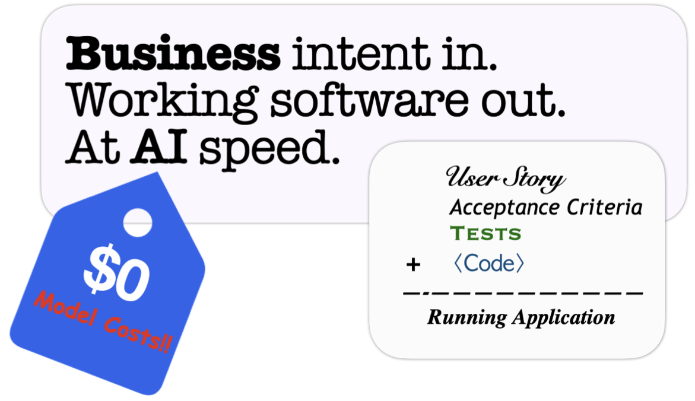

<p align="center">
  
</p>

<h1 align="center">OpenMission</h1>

<h1 align="center">
  
</h1>


<p align="center">
  <a href="#-get-started"><strong>Start Building</strong></a>
  &nbsp;&nbsp;·&nbsp;&nbsp;
  <a href="#how-openmission-works"><strong>How It Works</strong></a>
</p>

---

<p align="center">
  <a href="#what-openmission-creates">What It Creates</a> ·
  <a href="#why-openmission">Why OpenMission</a> ·
  <a href="#-get-started">Get Started</a> ·
  <a href="#-requirements">Requirements</a> ·
  <a href="#feedback">Feedback</a> ·
  <a href="#-data-and-operations">Operations</a> ·
  <a href="#-troubleshooting">Troubleshooting</a>
</p>

<p align="center">
  
  
  
  
  <a href="LICENSE"></a>
</p>

> [!IMPORTANT]
> **Public technical preview:** OpenMission is available for experimentation and feedback. It is still evolving and is not recommended for production use. This source-free Docker deployment contains no OpenMission product source and performs no local OpenMission image builds.

> [!WARNING]
> **AI can make mistakes.** Generated requirements, code, and tests may be incomplete or incorrect. Passing automated tests does not guarantee the application meets your intent or is secure. Review the output and verify critical workflows yourself before relying on it.

## How OpenMission Works

OpenMission turns a business need into one connected, testable delivery chain:

1. **Describe the business need.** Start with the outcome the application must deliver.
2. **Shape the User Stories.** OpenMission turns the need into clear, reviewable application behavior.
3. **Define Acceptance Criteria.** Each capability receives observable conditions for success.
4. **Create executable tests.** The criteria become tests that can verify the visible application.
5. **Build the code.** OpenMission implements against the approved behavior and test evidence.
6. **Run and verify the application.** Browser validation confirms what the application actually does.


> OpenMission verifies observable application behavior against the Acceptance Criteria. It does not replace engineering review for architecture, security, integrations, operations, compliance, or production readiness.

## ⚡ Get Started

### Install on an Apple Silicon Mac with the DMG

1. **[Download OpenMission for Mac (Apple Silicon)](https://github.com/CharlieKuharski/openmission-deploy/raw/refs/heads/main/macos/OpenMission.dmg)**. Open the disk image, drag **OpenMission** to **Applications**, then open it. The launcher requires macOS 14 or later.
2. If prompted, select **Install Docker Desktop** or **Install Ollama**. Finish the vendor installer and open the app. Docker runs OpenMission’s services. Ollama runs the models on your Mac.
3. Review the **Thinking** and **Coding** models and their approximate download sizes. Choose **Download and use** to start the services and pull any missing models. OpenMission opens in your browser when setup finishes.

On 16–23 GB Macs, the launcher suggests `qwen3.5:4b` for both roles. On 24–31 GB Macs, it suggests `qwen3.5:9b` for both. A shared model downloads once. At 32 GB and up, it suggests the dedicated pairs in the [memory table](#recommended-ollama-models-by-memory). Below 16 GB, it suggests `hermes3:3b` for Thinking and asks you to choose a Coding model. You can enter different Ollama tags during setup or change models later in **Utility**.

Opening the launcher again takes you to your running installation. It offers to restart services for a stopped installation it created. Its projects and settings are stored under `~/Library/Application Support/OpenMission/`.

The DMG is an ad-hoc-signed test build. [Build or verify the disk image](macos/README.md). For a terminal installation, follow the steps below.

### 1. Install the prerequisites

- [Docker with Docker Compose](https://docs.docker.com/get-started/get-docker/)
- [Ollama](https://ollama.com/download)

#### Fresh macOS installation (Apple Silicon)

1. Install [Docker Desktop for Mac](https://docs.docker.com/desktop/setup/install/mac-install/), choosing the Apple Silicon download. Move Docker to Applications, open it, complete the first-run setup, and wait for the Docker engine to start. Docker Desktop includes Docker Compose.
2. Install [Ollama for macOS](https://docs.ollama.com/macos), move it to Applications, and open it. Complete its command-line setup so `ollama` is available in Terminal. Keep Ollama running directly on macOS so it can use the Mac's GPU.
3. Open a new Terminal window and check both prerequisites:

```bash
docker version
docker compose version
curl --fail --show-error http://127.0.0.1:11434/api/tags
```

`docker version` must show both Client and Server information. The Ollama check must return JSON; an empty model list is normal before the next step. If a command is missing, finish the application's command-line setup and reopen Terminal. If a connection fails, open the corresponding application and wait for it to finish starting.

Docker and Ollama must stay running while you use OpenMission. Compose starts the OpenMission services; it does not install or launch these Mac applications. Keep the supplied `OPENMISSION_OLLAMA_BASE_URL=http://host.docker.internal:11434/v1` for this setup: [Docker Desktop provides that hostname](https://docs.docker.com/desktop/features/networking/networking-how-tos/#connect-a-container-to-a-service-on-the-host) so containers can reach Ollama on your Mac. No Ollama installation-folder or model-storage path is needed in Compose.

### 2. Choose and pull models for your computer

Use the [model recommendations by memory](#recommended-ollama-models-by-memory) below to choose a Thinking model and a Coding model. Start with `hermes3:8b` for Thinking, or consider `hermes3:3b` when memory is constrained. Coding options and alternatives are drawn from Ollama's published library, regardless of which models are already installed.

For example, a Mac with **48 GB unified memory** can start with:

```bash
ollama pull hermes3:8b
ollama pull qwen3-coder:30b
```

### 3. Download and start OpenMission

Clone the immutable RC21 deployment:

```bash
git clone --branch v0.1.0-rc.22 --depth 1 https://github.com/CharlieKuharski/openmission-deploy.git openmission

cd openmission
cp .env.example .env
```

Before starting, set the model names in `.env` to the models you chose. For the 48 GB example:

```dotenv
OPENMISSION_CHAT_MODEL=hermes3:8b
OPENMISSION_CODE_GEN_MODEL=qwen3-coder:30b
OPENMISSION_OLLAMA_MODEL=qwen3-coder:30b
```

On Linux, set the Docker socket group in the shell used for Compose (or save the numeric value as `OPENMISSION_DOCKER_GID` in `.env`):

```bash
export OPENMISSION_DOCKER_GID="$(stat -c '%g' /var/run/docker.sock)"
```

Docker Desktop for Mac uses the default group `0`; do not run the Linux command on macOS.

For a fresh installation, prepare storage and start the deployment:

```bash
docker compose --env-file .env pull
docker compose --env-file .env run --rm --no-deps --user 0 api /app/openmission-api prepare-runtime
docker compose --env-file .env up -d --wait
```

On a fresh Mac, run the [container connection checks](#macos-check-docker-and-ollama-from-the-containers) below before building your first project. Container health alone does not verify access to Ollama or the Docker engine used for generated applications.

### 4. Open OpenMission

Visit [http://127.0.0.1:15173](http://127.0.0.1:15173).

On first startup, OpenMission opens the Utility screen. Use it to:

- Verify the Ollama connection
- Pull additional models by name
- Choose the global Thinking model
- Choose the global Coding model

Docker Compose pulls and starts the complete configured stack. No OpenMission source checkout or local image build is required.

## 🧩 Included Services

The deployment includes:

- [OpenMission API](https://hub.docker.com/r/charliekuharski/openmission)
- [OpenMission UI](https://hub.docker.com/r/charliekuharski/openmission-ui)
- [OpenMission Hermes](https://hub.docker.com/r/charliekuharski/openmission-hermes)
- Browserless
- Playwright MCP
- SearXNG

## 🖥️ Requirements

| Platform | Status |
| --- | --- |
| macOS on Apple Silicon with Docker Desktop | Validated |
| Linux AMD64 with Docker Engine and Compose | **Validation pending**  |
| Windows and WSL2 | **Validation pending** |

OpenMission runs Ollama directly on the host so local models can use the host's GPU acceleration.

### Recommended Ollama models by memory

These recommendations use the models and sizes published in [Ollama's library](https://ollama.com/library), checked **November 10, 2026**, rather than the models already installed on your computer. They consider task suitability and memory headroom for OpenMission.

**Thinking:** Start with Hermes3 for requirements, user stories, and acceptance criteria. Use 3B on smaller machines and 8B where memory allows. [Hermes3](https://huggingface.co/NousResearch/Hermes-3-Llama-3.1-8B) supports instruction following, function calling, and structured output.

**Coding:** Use Qwen3.5 on smaller machines, Qwen3-Coder 30B for dedicated agentic coding, and Qwen3-Coder-Next on larger machines.

On Apple Silicon, use total unified memory to choose a row. With a discrete GPU, use **GPU VRAM** for model fit and reserve separate system RAM for the OS, Docker, builds, and browsers. Actual memory use varies with context length and the number of loaded models.

| Unified memory / GPU VRAM tier | Thinking model | Coding model | Guidance |
| --- | --- | --- | --- |
| Below 16 GB | `hermes3:3b` | — | Lightweight planning; the complete local build workflow needs more headroom on a shared-memory machine. |
| 16–23 GB | `hermes3:3b` | `qwen3.5:4b` | Compact pair for smaller projects. Load models sequentially to conserve memory. |
| 24–31 GB | `hermes3:8b` | `qwen3.5:9b` | More capacity for planning and coding while leaving room for application services. |
| 32–47 GB | `hermes3:8b` | `qwen3-coder:30b` | Dedicated coding model; load models sequentially and watch context memory. |
| 48–63 GB | `hermes3:8b` | `qwen3-coder:30b` | Recommended starting pair for a 48 GB Mac. |
| 64–95 GB | `hermes3:8b` | `qwen3-coder:30b` | Extra headroom for longer context, builds, and browsers. |
| 96–127 GB | `hermes3:8b` | `qwen3-coder-next:q4_K_M` | Larger model designed for agentic coding. |
| 128 GB and above | `hermes3:8b` | `qwen3-coder-next:q8_0` | Higher-precision coding model; use Q4 for more memory headroom. |

Ollama lists approximate download sizes of **2.0 GB** for [Hermes3 3B](https://ollama.com/library/hermes3:3b), **4.7 GB** for [Hermes3 8B](https://ollama.com/library/hermes3:8b), **3.3–4 GB** for [Qwen3.5 4B](https://ollama.com/library/qwen3.5:4b), **6.6–7.6 GB** for [Qwen3.5 9B](https://ollama.com/library/qwen3.5:9b), **19 GB** for [Qwen3-Coder 30B](https://ollama.com/library/qwen3-coder), and **52 GB / 85 GB** for [Qwen3-Coder-Next Q4 / Q8](https://ollama.com/library/qwen3-coder-next). Runtime memory also includes context caches and buffers.

For larger Thinking models, [Hermes3 70B](https://ollama.com/library/hermes3:70b) is an option with a roughly **40 GB** download. [Qwen3.5 9B and 27B](https://ollama.com/library/qwen3.5) are reasoning-capable alternatives. Allow room for the Coding model and context when choosing a larger Thinking model.

On shared-memory computers, reserve roughly **8–12 GB** for the OS, Docker, builds, and browsers, with more for large applications. [Ollama recommends at least 64,000 context tokens for agents and coding tools](https://docs.ollama.com/context-length). Configure context in Ollama and use `ollama ps` during a run to check allocated context and GPU offloading. Longer context uses more memory; CPU offloading can slow generation.

Pull each chosen model with `ollama pull <model>`. Before first startup, set `OPENMISSION_CHAT_MODEL` to the Thinking model, and both `OPENMISSION_CODE_GEN_MODEL` and `OPENMISSION_OLLAMA_MODEL` to the Coding model. In an existing deployment, select the global Thinking and Coding models in the Utility screen.

A practical reference system for the 48 GB tier is:

```text
Mac with Apple M4 Pro
48 GB unified memory
1 TB SSD
Docker Desktop
Ollama running on macOS
```

Model size affects generation quality, speed, and the memory available for Docker builds and browser validation. The deployment's packaged fallback values remain `hermes3:8b` for Thinking and `qwen3-coder:30b` for Coding; use the guide above to choose settings appropriate to your hardware.

## Feedback

Trying the public technical preview? Your feedback is valuable.

[Share your experience or report a problem](https://github.com/CharlieKuharski/openmission-deploy/issues/new).

Useful feedback includes:

- Bugs and unexpected behavior
- Installation or upgrade problems
- Feature requests
- Project-generation results
- Whether the generated project improved the handoff to developers

When useful, include:

- OpenMission version
- Operating system and hardware
- Selected Thinking and Coding models
- Expected and actual behavior
- Sanitized screenshots or logs

Do not publish `.env` values, credentials, private prompts, confidential generated source, or other sensitive information in a public issue.

## 💾 Data and Operations

OpenMission keeps its primary data beside the deployment:

- `./workspace` — generated applications, source, tests, and evidence
- `./data` — OpenMission SQLite database
- `openmission-hermes-data` — Compose-managed Hermes runtime volume

### Check service health

```bash
docker compose --env-file .env ps
curl -f http://127.0.0.1:18080/api/health
```

### Restart without deleting data

```bash
docker compose --env-file .env restart
```

### Stop while preserving data

```bash
docker compose --env-file .env down
```

### Back up project data

Stop OpenMission, then run:

```bash
tar -czf "openmission-backup-$(date +%Y%m%d).tar.gz" workspace data
```

> [!CAUTION]
> Do not use `docker compose down --volumes` unless you intend to remove the Hermes runtime volume. Do not delete `workspace` or `data` unless you intend to remove generated projects or OpenMission state.

## Update OpenMission

Deployment release `v0.1.0-rc.22` points to Docker Hub build `sha-b12c24cd401dd847dcce6753fe7cec9952b1ccec` for the API, UI, and Hermes images.

The deployment tag selects the installer. The three images use the matching OpenMission source revision.

- Main builds started with RC22 can pause and resume at the interrupted acceptance criterion in the same workspace. Completed criteria retain their results and evidence.
- Main runs final regression over the criteria that passed and the factory tests. If no criteria pass, OpenMission skips final regression and reports the failed criteria.
- Task runs have a visible final regression step for that Task’s criteria.

Before updating:

1. Wait for builds, tasks, Chat runs, and security repairs to finish; stop generated applications.
2. Stop OpenMission with `docker compose --env-file .env down`, then back up `data` and `workspace`. Keep the Hermes volume.
3. Preserve your existing `.env`, including credentials and model settings.
4. Do not replace `.env` with `.env.example`.

Release startup preserves SQLite data. This release requires a one-time `prepare-runtime` command to make existing storage writable by the non-root API. Keep all workspace writers stopped during preparation. It changes ownership and permissions, not project or database contents. Skipped links or special files are reported for review.

On Linux, set `OPENMISSION_DOCKER_GID` as shown in the installation steps before running the update commands. Preserve custom `HERMES_GID` settings.

To move to a newer tested release:

```bash
DEPLOY_RELEASE=v0.1.0-rc.22
NEW_VERSION=sha-b12c24cd401dd847dcce6753fe7cec9952b1ccec

git fetch --tags
git switch --detach "${DEPLOY_RELEASE}"
sed -i "" "s/^OPENMISSION_VERSION=.*/OPENMISSION_VERSION=${NEW_VERSION}/" .env
docker compose --env-file .env pull
docker compose --env-file .env run --rm --no-deps --user 0 api /app/openmission-api prepare-runtime
docker compose --env-file .env up -d --wait --force-recreate
```

Set `NEW_VERSION` to the published build or release you are installing. Use its matching deployment configuration and review the changes before updating.

The `sed` command above is for macOS. On Linux, use `sed -i` without the empty argument. No local image build is needed.

### Optional timeout settings

```bash
OPENMISSION_PROJECT_TIME_PER_AC=30m
OPENMISSION_AC_TIME_PER_TEST=10m
```

The project deadline is the approved Acceptance Criteria count multiplied by the project rate. Each implementation or repair attempt receives the current AC's discovered test count multiplied by the per-test rate, with a 30-minute minimum. The project deadline can still end an attempt sooner. Preserve any existing custom values.

## 🔒 Security

All published ports bind to `127.0.0.1` by default.

The values supplied in `.env.example` are local-only defaults. Replace every value ending in `change-me` before remote access, reverse-proxy exposure, cloud deployment, or use on a shared machine.

Generate replacement values with:

```bash
openssl rand -hex 32
```

The API and Hermes containers mount `/var/run/docker.sock` so OpenMission can build and validate generated applications. Docker socket access is equivalent to host-level administrative control.

Run OpenMission only on a machine and with container images you trust.

## 🛠️ Troubleshooting

### Confirm that Ollama is available

```bash
ollama list
curl -f http://127.0.0.1:11434/api/tags
```

### macOS: check Docker and Ollama from the containers

After starting OpenMission, run these from the deployment directory. The Docker checks should print a server version, the API's Ollama check should exit successfully, and the Hermes check should print `Ollama reachable from Hermes`.

```bash
docker compose --env-file .env exec -T api docker info --format '{{.ServerVersion}}'
docker compose --env-file .env exec -T --user hermes hermes-gateway docker info --format '{{.ServerVersion}}'
docker compose --env-file .env exec -T api wget -q -T 10 -O /dev/null http://host.docker.internal:11434/api/tags
docker compose --env-file .env exec -T --user hermes hermes-gateway /opt/hermes/.venv/bin/python -c \
  'import urllib.request; urllib.request.urlopen("http://host.docker.internal:11434/api/tags", timeout=10).close(); print("Ollama reachable from Hermes")'
```

If Docker access fails, confirm Docker Desktop is running and `docker context show` reports `desktop-linux` for this setup. If Ollama access fails, confirm the Ollama app is running and the host check above succeeds. These commands check the supplied Mac defaults; `localhost` inside a container refers to that container, not your Mac.

### Inspect service status and recent logs

```bash
docker compose --env-file .env ps
docker compose --env-file .env logs --tail 100 api ui hermes-gateway
```

On macOS, keep this repository under a directory shared with Docker Desktop so generated project bind mounts are available to Docker.

## 🚀 What's Next

OpenMission is being expanded beyond the public technical preview. Planned future releases include:

- Public application source
- OpenMission Cloud
- Broader platform validation
- Continued improvements based on project-generation evidence and user feedback

## License

The deployment is available under the [Apache License 2.0](LICENSE).
