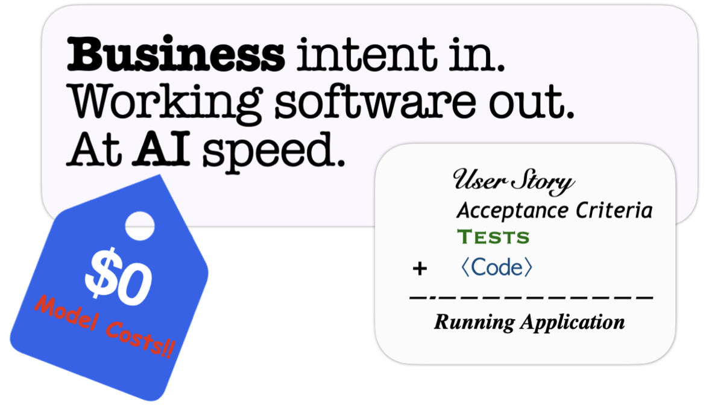

<p align="center">
  
</p>

<h1 align="center">OpenMission</h1>

<h1 align="center">
  
</h1>


<p align="center">
  <a href="#-get-started"><strong>Start Building</strong></a>
  &nbsp;&nbsp;·&nbsp;&nbsp;
  <a href="#how-openmission-works"><strong>How It Works</strong></a>
</p>

---

<p align="center">
  <a href="#what-openmission-creates">What It Creates</a> ·
  <a href="#why-openmission">Why OpenMission</a> ·
  <a href="#-get-started">Get Started</a> ·
  <a href="#-requirements">Requirements</a> ·
  <a href="#feedback">Feedback</a> ·
  <a href="#-data-and-operations">Operations</a> ·
  <a href="#-troubleshooting">Troubleshooting</a>
</p>

<p align="center">
  
  
  
  
  <a href="LICENSE"></a>
</p>

> [!IMPORTANT]
> **Public technical preview:** OpenMission is available for experimentation and feedback. It is still evolving and is not recommended for production use. This source-free Docker deployment contains no OpenMission product source and performs no local OpenMission image builds.

> [!WARNING]
> **AI can make mistakes.** Generated requirements, code, and tests may be incomplete or incorrect. Passing automated tests does not guarantee the application meets your intent or is secure. Review the output and verify critical workflows yourself before relying on it.

## How OpenMission Works

OpenMission turns a business need into one connected, testable delivery chain:

1. **Describe the business need.** Start with the outcome the application must deliver.
2. **Shape the User Stories.** OpenMission turns the need into clear, reviewable application behavior.
3. **Define Acceptance Criteria.** Each capability receives observable conditions for success.
4. **Create executable tests.** The criteria become tests that can verify the visible application.
5. **Build the code.** OpenMission implements against the approved behavior and test evidence.
6. **Run and verify the application.** Browser validation confirms what the application actually does.


> OpenMission verifies observable application behavior against the Acceptance Criteria. It does not replace engineering review for architecture, security, integrations, operations, compliance, or production readiness.

## ⚡ Get Started

### 1. Install the prerequisites

- [Docker with Docker Compose](https://docs.docker.com/get-started/get-docker/)
- [Ollama](https://ollama.com/download)

### 2. Pull the default local models

```bash
ollama pull hermes3:8b
ollama pull qwen3-coder:30b
```

### 3. Download and start OpenMission

Clone the immutable RC18 deployment:

```bash
git clone --branch v0.1.0-rc.18 --depth 1 https://github.com/CharlieKuharski/openmission-deploy.git openmission

cd openmission
cp .env.example .env
docker compose --env-file .env pull
docker compose --env-file .env up -d --wait
```

### 4. Open OpenMission

Visit [http://127.0.0.1:15173](http://127.0.0.1:15173).

On first startup, OpenMission opens the Utility screen. Use it to:

- Verify the Ollama connection
- Pull additional models by name
- Choose the global Thinking model
- Choose the global Coding model

Docker Compose pulls and starts the complete configured stack. No OpenMission source checkout or local image build is required.

## 🧩 Included Services

The deployment includes:

- [OpenMission API](https://hub.docker.com/r/charliekuharski/openmission)
- [OpenMission UI](https://hub.docker.com/r/charliekuharski/openmission-ui)
- [OpenMission Hermes](https://hub.docker.com/r/charliekuharski/openmission-hermes)
- Browserless
- Playwright MCP
- SearXNG

## 🖥️ Requirements

| Platform | Status |
| --- | --- |
| macOS on Apple Silicon with Docker Desktop | Validated |
| Linux AMD64 with Docker Engine and Compose | Validated |
| Linux ARM64 | Published images |
| Windows and WSL2 | **Validation pending** |

OpenMission runs Ollama directly on the host so local models can use the host's GPU acceleration.

The default 30B coding model needs substantial memory. A practical reference system is:

```text
Mac with Apple M4 Pro
48 GB unified memory
1 TB SSD
Docker Desktop
Ollama running on macOS
```

Machines with less memory can use smaller models selected from the Utility screen. Model size affects generation quality, speed, and the memory available for Docker builds and browser validation.

## Feedback

Trying the public technical preview? Your feedback is valuable.

[Share your experience or report a problem](https://github.com/CharlieKuharski/openmission-deploy/issues/new).

Useful feedback includes:

- Bugs and unexpected behavior
- Installation or upgrade problems
- Feature requests
- Project-generation results
- Whether the generated project improved the handoff to developers

When useful, include:

- OpenMission version
- Operating system and hardware
- Selected Thinking and Coding models
- Expected and actual behavior
- Sanitized screenshots or logs

Do not publish `.env` values, credentials, private prompts, confidential generated source, or other sensitive information in a public issue.

## 💾 Data and Operations

OpenMission keeps its primary data beside the deployment:

- `./workspace` — generated applications, source, tests, and evidence
- `./data` — OpenMission SQLite database
- `openmission-hermes-data` — Compose-managed Hermes runtime volume

### Check service health

```bash
docker compose --env-file .env ps
curl -f http://127.0.0.1:18080/api/health
```

### Restart without deleting data

```bash
docker compose --env-file .env restart
```

### Stop while preserving data

```bash
docker compose --env-file .env down
```

### Back up project data

Stop OpenMission, then run:

```bash
tar -czf "openmission-backup-$(date +%Y%m%d).tar.gz" workspace data
```

> [!CAUTION]
> Do not use `docker compose down --volumes` unless you intend to remove the Hermes runtime volume. Do not delete `workspace` or `data` unless you intend to remove generated projects or OpenMission state.

## Update OpenMission

Deployment release `v0.1.0-rc.18` points to Docker Hub build `sha-98b279fbd92f5afdf5f09339aff7b0e5449a3786` for the API, UI, and Hermes images.

The deployment release tag and Docker image tag are intentionally distinct. This release:

- Adds folder-path copying on the Code Base page with temporary button feedback
- Places Acceptance Criteria summaries beneath their respective AC details
- Retains the pinned third-party dependency images from RC17

Before updating:

1. Wait for active project and Chat runs to finish.
2. Back up your data.
3. Preserve your existing `.env`, including credentials and model settings.
4. Do not replace `.env` with `.env.example`.

Release startup preserves SQLite data.

To move to a newer tested release:

```bash
DEPLOY_RELEASE=v0.1.0-rc.18
NEW_VERSION=sha-98b279fbd92f5afdf5f09339aff7b0e5449a3786

git fetch --tags
git switch --detach "${DEPLOY_RELEASE}"
sed -i "" "s/^OPENMISSION_VERSION=.*/OPENMISSION_VERSION=${NEW_VERSION}/" .env
docker compose --env-file .env pull
docker compose --env-file .env up -d --wait
```

Set `NEW_VERSION` to the published build or release you are installing. Use its matching deployment configuration and review the changes before updating.

The `sed` command above is for macOS. On Linux, use `sed -i` without the empty argument. No local image build is needed.

### Optional timeout settings

```bash
OPENMISSION_PROJECT_TIME_PER_AC=30m
OPENMISSION_AC_TIME_PER_TEST=10m
```

The project deadline is the approved Acceptance Criteria count multiplied by the project rate. Each implementation or repair attempt receives the current AC's discovered test count multiplied by the per-test rate, with a 30-minute minimum. The project deadline can still end an attempt sooner. Preserve any existing custom values.

## 🔒 Security

All published ports bind to `127.0.0.1` by default.

The values supplied in `.env.example` are local-only defaults. Replace every value ending in `change-me` before remote access, reverse-proxy exposure, cloud deployment, or use on a shared machine.

Generate replacement values with:

```bash
openssl rand -hex 32
```

The API and Hermes containers mount `/var/run/docker.sock` so OpenMission can build and validate generated applications. Docker socket access is equivalent to host-level administrative control.

Run OpenMission only on a machine and with container images you trust.

## 🛠️ Troubleshooting

### Confirm that Ollama is available

```bash
ollama list
curl -f http://127.0.0.1:11434/api/tags
```

### Inspect service status and recent logs

```bash
docker compose --env-file .env ps
docker compose --env-file .env logs --tail 100 api ui hermes-gateway
```

On macOS, keep this repository under a directory shared with Docker Desktop so generated project bind mounts are available to Docker.

## 🚀 What's Next

OpenMission is being expanded beyond the public technical preview. Planned future releases include:

- Public application source
- OpenMission Cloud
- Broader platform validation
- Continued improvements based on project-generation evidence and user feedback

## License

The deployment is available under the [Apache License 2.0](LICENSE).
